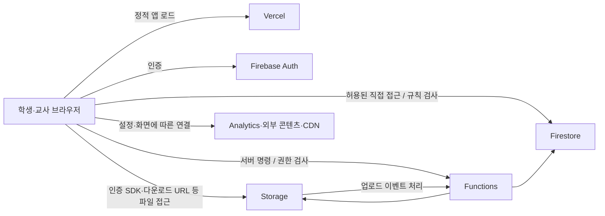

# 학교 정보화사업 보안성 검토 대비

작성일: 2026-10-28 (Asia/Seoul). 상태: **내부 준비 초안 / 기관 확인·공문 제출 전**.
소스 기준: `6d878b429c7c6c01100d13b1e792dc533291ec8b`. 운영 배포 일치 여부와 기존 보안성 검토 이력은 이번 작업에서 확인하지 않았다.

## 안내의 확인 상태

사용자는 연구회를 통해 다음 취지의 안내를 전달받았다: AI 바이브 코딩으로 개발한 소프트웨어도 사전 보안성 검토가 필요하며, 정보화팀에 공문으로 제출하면 검토·경유 후 도를 거쳐 국정원으로 전달한다는 내용이다. 사용자 확인에 따르면 공문번호는 없다. 관할 교육청, 안내 원문, 시행일, 적용 범위 및 미검토 시 조치의 세부 근거는 미확인이다.

이 안내는 사전 준비의 근거로 보존한다. ‘전국의 모든 바이브 코딩 소프트웨어가 예외 없이 국정원 직접 검토 대상’이라는 확정 규정이나 새로운 시행일로 표현하지 않는다. 공개 검색에서 그 포괄적 문구에 해당하는 공식 원문은 확인하지 못했으며, 이것을 해당 기관 내부 안내가 없다는 증거로도 취급하지 않는다.

## 공개 자료와 적용 판단

| 근거 | 확인 범위 |
| --- | --- |
| [교육부 정보보안 기본지침](https://www.law.go.kr/admRulInfoP.do?admRulSeq=2100000231430), 공개 열람판 2023-11-21 | 제14~18조는 계획 단계의 검토, 검토 기관·생략, 제출 문서와 결과 반영을 구분한다. 국정원 의뢰는 해당 범위에서 상급기관을 경유하며, 모든 건의 동일한 직접 제출 절차로 설명하지 않는다. |
| [울산교육청 보안성 검토 안내](https://use.go.kr/www/eduinfo/protect/security/security03.jsp), 표시 수정일 2026-02-19 | 국정원 의뢰·자체 검토·생략 사업을 구분하고 신청과 준비 문서를 안내한다. 관할별 절차가 있음을 보여주는 참고이며 위스토리의 관할·면제 근거로 적용하지 않는다. |
| [경남교육청 법령·지침 목록](https://gnei.gne.go.kr/boho/cm/cntnts/cntntsView.do?cntntsId=7071&mi=13435), 2026-10-28 열람 | ‘국가 사이버보안 기본지침’ 2026-05-01 개정 표기를 확인했다. 해당 개정 전문과 학교에 배포된 최신 매뉴얼을 이번 조사에서 확보한 것은 아니다. 공개된 교육부 2023판만으로 최신 내부 기준을 대체하지 않는다. |

학교에서 실제 적용할 최신 지침·서식·경유 기관은 담당 정보화팀 또는 정보보안담당관의 확인을 받는다. ‘도’가 어느 기관인지, 교육부 등 추가 경유가 필요한지도 확인한다. 개발비가 없거나 교사가 자체 제작했다는 사유, 앱이 외부 AI API를 호출하지 않는다는 사유만으로 제외를 판단하지 않는다. 개발 단계의 AI 사용과 운영 단계의 AI 서비스 연동은 각각 기재한다.

보안성 검토, 소프트웨어 보안약점 진단, 정보보호제품의 보안적합성 검증, 개인정보 관련 검토는 같은 절차로 취급하지 않는다. 적용 여부는 각각 확인하며 빌드 성공이나 클라우드 사업자의 인증으로 기관 검토 완료를 대신하지 않는다. 미검토의 구체적인 불이익·책임은 근거를 받기 전 단정하지 않는다.

## 위스토리 현황 초안

다음은 코드와 기존 운영 문서에 대한 확인이다. 실제 데이터 조회·침투 테스트·운영 설정 변경은 수행하지 않았다. **설정 또는 검사 코드가 존재한다는 사실은 현재 운영에서의 강제·검증 완료를 뜻하지 않는다.**

| 항목 | 작성 가능한 현황 | 추가 확보할 증빙 |
| --- | --- | --- |
| 목적·이용자 | 학생 학습과 교사 수업·평가 운영을 지원하는 웹 서비스. 학생/교사 포털 분리 | 도입 학교, 업무 책임자, 실제 이용자 수·연령, 사용 시작일, 기존 검토·승인 문서 |
| 앱·배포 | React·TypeScript·Vite. 기존 [운영 절차](production-release.md)는 Vercel과 `www.westory.kr`을 운영 경로로 기록 | 제출 시점 운영 커밋, 배포 구성, 계정 소유·관리 책임, 개발/검증/운영 환경 분리 |
| 백엔드·위치 | [Firebase 초기화](../../src/lib/firebase.ts)에 Auth·Firestore·Storage·Functions 연결. Functions 호출에 서울·미국 리전이 함께 있으며 기존 운영 문서는 Firestore `nam5`를 언급 | 서비스별 실제 저장·처리·백업 지역, 계약·위탁·국외 처리 근거. ‘전부 국내 처리’로 작성하지 않음 |
| 학생·학습 자료 | [학적 구조](../../src/lib/studentRoster.ts), [Firestore 규칙](../../firestore.rules)에 이름·학교 이메일·학년/반/번호·학적 상태, 출석, 답안·점수·평가 확인 서명 등의 경로가 있음 | 실제 수집 필드, 목적·처리 근거, 고지/동의, 조회 주체, 보유·파기 기준. 법률상 정보 분류는 별도 확인 |
| 파일 | [Storage 규칙](../../storage.rules)에 PDF·지도·공지 이미지 등의 경로가 있으며 다운로드 토큰 URL 생성 코드도 존재 | 업로드 허용 범위·검사, SDK 접근과 다운로드 토큰 URL의 공유·회수·권한 적용 범위, 삭제·백업 정책, 교과 자료 이용 권한 |
| 인증·권한 | [세션 권한](../../functions/sessionAuthority.js), Firestore/Storage 규칙에 세션·역할·본인·학기별 검사. 일부 직접 쓰기 차단 | 운영 규칙 버전, 계정 발급·퇴직/전학 시 회수, 관리자 MFA·IAM, 부정 접근 거부 증빙 |
| App Check·감사 | [App Check](../../src/lib/appCheck.ts) 초기화, [명령 게이트웨이](../../functions/productionGateway/commandGateway.js)의 영수증·감사 이벤트 코드 | 운영 강제 모드, 로그 접근·보존·점검, 사고 대응 담당자·연락 체계 |
| 부가 외부 연결 | Firebase Analytics 조건부 초기화, Google 로그인, [지도](../../src/lib/mapResources.ts)·[교사 지정 iframe](../../src/components/common/MapViewer.tsx)·[YouTube 수업 자료](../../src/pages/student/lesson/components/LessonContent.tsx)·[Quill CDN](../../src/components/common/QuillEditor.tsx) 코드 | 실제 활성 경로·외부 도메인·전송 필드·쿠키, 허용 범위와 개인정보 고지. 전체 외부 통신 목록을 확정한 결과는 아님 |
| AI 개발·운영 | 이번 문서·개발 작업에 AI 코딩 도구 사용. [AI 사용 검토](responsible-ai.md)는 조사 범위 내 런타임 모델 호출 미발견을 기록 | 개발 도구·사용 범위·외부로 전달한 자료의 관리 이력. 운영 AI 도입 이력은 별도 확인 |

개략적인 논리 구성은 다음과 같다. 실제 망 구성·지역·접속 허용 정책은 운영 증빙으로 보완한다.

개발 중 AI 도구로 보내는 소스·문맥은 위 운영 흐름과 별도로 관리한다. 실제 학생 데이터, 인증정보, 비공개 기관 자료를 개발 프롬프트나 저장소의 제출 초안에 넣지 않는다.

## 제출 준비 목록

교육부 공개 지침 제17조의 개요·사업계획·제안요청서·망 구성·자체 보안대책을 참고한 **내부 준비 목록**이다. 기관이 지정한 최신 서식으로 옮기며, 자체 개발이라 제안요청서가 없는 경우 대체 자료 또는 해당 없음 처리 방법을 담당부서에 확인한다.

| 준비물 | 현재 준비·보완 내용 |
| --- | --- |
| 사업 개요·계획 | 위 현황을 바탕으로 목적, 학교·이용자, 도입/변경 범위, 일정·책임자를 작성. 이미 운영 중인 서비스라는 사실과 시작일을 정확히 기재 |
| 시스템·자료 흐름 | 위 개략도에 실제 서비스·리전·외부 통신·개인정보 흐름을 대조. 상세 IP·계정·내부망 정보는 기관 지정 제한자료로 분리 |
| 자체 보안대책 | 관리: 책임자·권한 회수·변경/사고 대응. 물리: 관리자 단말·저장매체·클라우드 책임 분담. 기술: 인증/권한·암호화·파일/외부 연결·로그·백업/복구. 각 항목의 실제 증빙과 보완 계획을 구분 |
| AI 개발·공급망 | AI 활용 단계·사람의 코드 검토, 소스 기준 SHA, `package-lock.json`·`functions/package-lock.json` 기반 의존성/라이선스, 비밀정보·취약점 점검 결과 및 조치 이력. SBOM 등 요구 형식은 확인 |
| 개발·보안 검증 | 검사 범위·환경·기준 커밋·실행일·결과·미해결 사항을 기록. 아래 스크립트의 존재만으로 통과 판정을 기재하지 않음 |
| 운영·개인정보 | 관리계정/IAM·MFA, App Check 강제 상태, HTTP 보안 헤더, 로그 보존·열람, 백업·복구 시험, 개인정보 처리 근거·국외 처리·위탁·파기, 서비스 종료 시 자료 처리 증빙 |
| 기관 회신·조치 | 대상 여부, 검토 기관·경유, 제출 서식·기한, 기존 운영의 처리, 유지보수/재검토 경계, 보완 요청·조치·확인 일자를 별도 보관 |

검증 증빙의 출발점은 [앱 검사 정의](../../package.json), [Functions 검사 정의](../../functions/package.json), [인증 안정화 기록](../reviews/auth-session-stability-20261019.md), [세션 유지 기록](../reviews/session-retention-20261022.md), [성적·학적 검토 기록](../reviews/score-roster-workflow-20261007.md)이다. `npm run build`, `npm --prefix functions run check`, `test:login-session`, `test:student-access`, `test:lesson-assets` 등 관련 검사를 제출 기준 버전에서 선별 실행하고 로그를 남긴다. 공급망 IOC 검사 하나를 전체 취약점 점검으로 표현하지 않는다. 이번 문서 작업에서는 이 검사들을 새로 실행하지 않았다.

제출본에는 가상 예제와 식별정보를 제거한 증빙을 사용한다. 실제 명단·답안·서명, 서비스 계정 키, 관리자 토큰, 내부 지침 전문을 저장소나 공개 링크에 올리지 않는다. 제한자료의 분류·전달 방법은 기관 담당자와 정한다.

## 담당부서 질의 초안 — 미발송

**제목: AI 개발 도구를 활용한 학교 웹 서비스의 보안성 검토 대상 및 절차 확인 요청(위스토리)**

학교 학습·수업 운영을 지원하는 웹 서비스 ‘위스토리’를 운영하고 있으며, 개발·수정 과정에 AI 코딩 도구를 활용하고 있습니다. 연구회를 통해 관련 소프트웨어의 사전 보안성 검토 안내를 전달받아 다음 사항을 확인하고자 합니다.

1. 적용되는 최신 지침·공문·매뉴얼과 시행일, 본 서비스의 검토 대상 여부 및 검토 기관·경유 절차를 안내해 주시기 바랍니다. 정보화팀→도→국정원이라는 전달 내용의 정확한 기관·추가 경유 여부도 확인 부탁드립니다.
2. 기존 운영 서비스에 필요한 신고·검토 절차, 검토 중 운영 조건, 제출 기한·서식 및 자체 개발의 제안요청서 대체 자료를 안내해 주시기 바랍니다. 미검토 시 조치 기준도 함께 확인 부탁드립니다.
3. 외부 클라우드·학생 개인정보·외부 콘텐츠 연결과 개발 단계의 AI 도구 이용에 필요한 추가 확인 자료를 안내해 주시기 바랍니다.
4. 통상 유지보수와 기능·이용자·처리 데이터·외부 연계 확대 시 재검토를 구분하는 기준, 승인 범위 기록 방법을 안내해 주시기 바랍니다.

사업 개요, 시스템 구성 및 처리 자료 현황을 준비하고 있으며, 지정 서식과 자료 전달 방법에 맞춰 제출하겠습니다.

이 문안은 사용자 검토를 위한 초안이다. 수신 기관·학교 명의·문서번호를 임의로 확정하거나 발송하지 않는다.

## 향후 패치 적용

- 신규 학교 도입, 학생 공개·이용자 확대, 개인정보 항목 추가, 인증·권한 또는 외부 서비스·저장/처리 위치의 중요한 변경에서는 기존 검토 범위와 달라지는 사항을 기록하고 대상·재검토 여부를 확인한다. 이는 내부 변경관리 기준이며 모든 항목이 법률상 자동 재심사 대상이라는 뜻은 아니다.
- 필요한 검토가 확인된 변경은 결과와 이행 조건을 확보한 후 운영에 반영한다. 기존 승인 범위의 유지보수는 그 판단 근거를 기록한다. 긴급 보안 패치는 해당 기관의 긴급조치·보고 절차에 맞춰 처리한다.
- 현재는 기존 검토 이력이 **미확인**이다. 임의로 승인·면제 처리하거나 기존 서비스를 중단하지 않는다. 기존 운영의 처리 방침은 담당부서에 확인할 우선 항목이다.
- 패치 기록은 `변경 범위 / 기존 검토 근거 / 대상·재검토 판단 / 확인 주체·일자 / 보완 조치 / 운영 반영 여부`로 남긴다. 기관 확인이 필요한 상태를 빌드 성공·푸시·문서 작성으로 완료 처리하지 않는다.

| 기준일 | 상태 | 다음 확인 |
| --- | --- | --- |
| 2026-10-28 | 연구회 안내 수신, 공개 자료 대조, 내부 현황·질의 초안 준비. 공문 미제출, 기관 회신·기존 승인 이력 미확인 | 담당 정보화팀/정보보안담당관의 적용 근거·경유·기존 운영 처리·재검토 범위 확인 |
